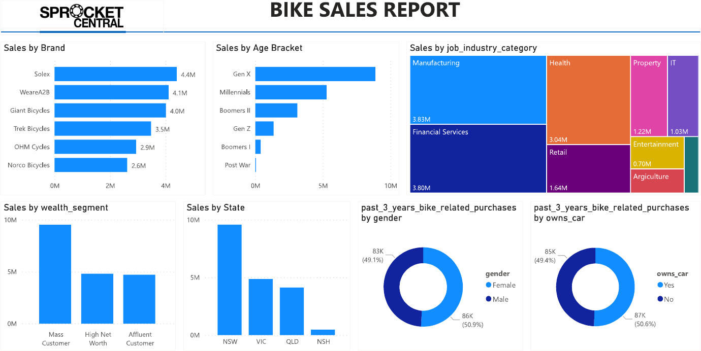

# Customer Segmentation for a Bike Retailer (KPMG Virtual Experience)

**Tools:** Power BI · **Program:** KPMG Australia Data Analytics virtual experience, delivered through Forage · **Data:** customer demographics, addresses and transactions for Sprocket Central, a fictional bike and accessories company

## Business question

Sprocket Central's marketing team received a list of **1,000 new customers** and wanted to know **which of them to target first** to grow sales.

## What I did

1. **Data quality assessment** of three datasets (customer demographics, customer addresses and transactions): checked completeness, consistency and accuracy, and gave the client recommendations on how to collect and store data better.
2. **Analyzed existing customers** to find the segments with the highest value.
3. **Built a Power BI report** showing sales by brand, age group, industry, wealth segment, state, gender and car ownership.
4. **Applied the findings to the 1,000 new customers** to recommend a target segment.

## Key findings

* **Mass customers** generate the highest value of all wealth segments.
* **Gen X customers (aged about 42 to 57)** buy the most.
* Customers in **Manufacturing** and **Financial Services** account for the highest sales.
* **New South Wales** is the strongest state.
* **Gender and car ownership** make no meaningful difference to purchases.

## Recommendations

* **Target first:** new customers in **New South Wales**, aged **Gen X**, in the **Mass** wealth segment, working in **Manufacturing or Financial Services**.
* **Strategy:** market penetration, focusing on the leading brands (**Solex** and **WeareA2B**) with price, promotion and distribution adjustments for existing products in existing markets.

## Files

| File | Contents |
|---|---|
| `BIKE SALES REPORT.pdf` | Power BI report |
| `images/` | Report image |
